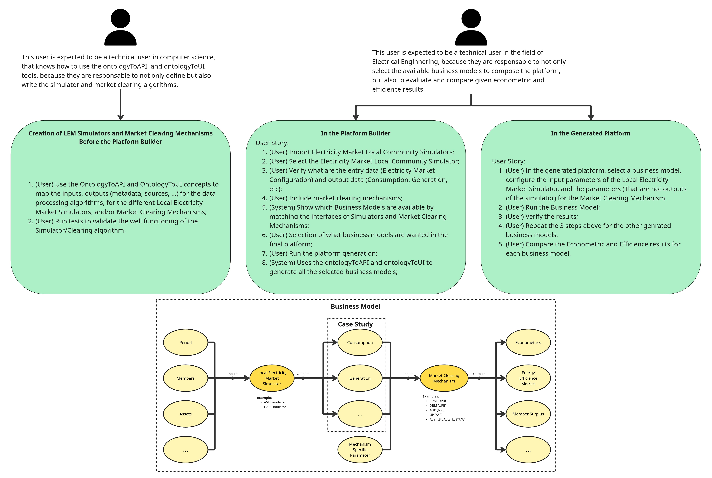

# Platform Builder

**Platform Builder** is a desktop IDE (Python + PySide6) that turns your own Python code into a web platform. You write *concepts* (an ontology `.ttl` describing a function's inputs and outputs, plus the `.py` that implements it), group them into *packages*, wire them together on a visual canvas, and Platform Builder generates and runs a REST API and a web UI for the resulting pipelines.

It is **application-agnostic**: it knows nothing about any domain. A concept is any function you describe with an ontology, and any output can feed any input of another concept as long as the types match. Simulators, optimizers, data connectors, ETL steps or ML models all work the same way.

It builds on two ontology-driven tools:

- [**OntologyToAPI**](https://pypi.org/project/ontologytoapi/) – exposes one REST endpoint per concept from its `.ttl`/`.py` pair.
> Author: [JCGCosta](https://github.com/JCGCosta)

- **OntologyToUI** (`OntologyToUI/`) – renders a web UI by reading the same ontologies.
> Author: [NewDaniC](https://github.com/NewDaniC/OntologyToUI)

---

## Table of Contents

1. [How it works](#how-it-works)
2. [Concepts and packages](#concepts-and-packages)
3. [The IDE](#the-ide)
4. [Platform generation](#platform-generation)
5. [Repository structure](#repository-structure)
6. [Installation](#installation)
7. [Usage](#usage)
8. [Project files](#project-files)
9. [Example application: SmartLEM](#example-application-smartlem)

---

## How it works

```
 ┌────────────────────┐   ┌─────────────────────┐   ┌──────────────────────────┐
 │ Concept packages   │   │ Canvas (User panel) │   │ Generated platform       │
 │  Name.ttl + Name.py│──►│ drag concepts,      │──►│  API  (OntologyToAPI)    │
 │  (your own code)   │   │ connect out → in    │   │  Web UI (OntologyToUI)   │
 └────────────────────┘   └─────────────────────┘   └──────────────────────────┘
        Admin panel              User panel                 Run / Stop
```

1. **Author** concepts in the *Admin panel* (or import existing packages).
2. **Compose** them in the *User panel*: each connected set of concepts becomes a pipeline (a "business model"), executed in dependency order.
3. **Generate and run**: one API endpoint per concept, and one UI view per pipeline. In the UI, only the inputs that are *not* fed by another concept are asked from the user.

## Concepts and packages

A **concept** is a pair of files with the same name:

| File | Role |
|------|------|
| `<Name>.ttl` | OntologyToAPI description: `bm:hasParameter` items are the **inputs**, `bm:hasOutputMetadata` items are the **outputs**, `excode:hasPythonFile` / `excode:hasFunction` point to the implementation. |
| `<Name>.py` | The entry point function, e.g. `async def Run<Name>(data)`. Inputs arrive in `data.params`; it returns `{"status": "OK", "desc": "...", "result": ...}`. |

A **package** is a folder of concepts; sub-folders group them (shown as `package > folder > concept` in the toolbox). Platform Builder loads every `.ttl` found under a package folder, so you organise packages however you like.

Linking rules (`src/core/catalog.py`):

- Output `out` of concept A can feed input `inp` of concept B when their types match (ports are colour-coded by type in the canvas).
- Inputs that no connection feeds are *exposed* to the platform user (a name used by more than one concept is prefixed with the concept name).
- Connected concepts are topologically sorted and executed in that order.

**UI objects** (`Graph`, `Table`, `Text`, `Image`) are built-in blocks available in every project. Connect any output to one to choose how a value is displayed in the generated UI (a graph series, a table of records, plain text or a base64 image). They are not served by the API; they only describe how to show a value.

## The IDE

The main window (`src/ui/main_window.py`) has two modes:

**Admin panel** (`src/ui/admin_panel.py`)
- Project explorer with the packages, folders and concept files.
- Code editor with syntax highlighting, line numbers, tabs, unsaved-changes handling and Python syntax checking (`src/ui/editor.py`).
- Create packages, folders and concepts (new concepts are generated from a template, `src/core/templates.py`).
- Rename, move and delete packages, folders and concepts. `src/core/reorganize.py` keeps everything consistent: the `excode:hasPythonFile` paths in the ontologies, the packages registered in the project and the concepts already placed on the canvas.

**User panel** (`src/ui/user_panel.py`, `src/ui/canvas.py`)
- Toolbox listing the loaded concepts and UI objects; drag them onto the canvas.
- Connect output ports to input ports; incompatible links are refused.
- Import a package folder, remove a package, reload concept files edited in the admin mode.
- Run/stop the platform, choosing API/UI host and ports.
- Edit the generated UI's texts and layout.

Other details: light/dark themes and font size through `qt-material`, and the last opened project and canvas position are remembered.

## Platform generation

Handled by `src/core/engine_integration.py` and `src/core/ui_generator.py`:

1. **API** – the `.ttl`/`.py` files of the concepts in use are copied into `src/generated/`, a `runAPI.py` is written (OntologyToAPI + FastAPI/uvicorn, with CORS for the UI) and started. Swagger docs are at `http://<api_host>:<api_port>/docs` (default `127.0.0.1:5000`).
2. **UI** – a Vite app is generated in `src/generated/ui/` that hosts `OntologyToUI`. One view (`.ttl`) is written per pipeline: its steps in execution order, the links between them, the inputs left to the user and the outputs chosen to be shown. The UI runs a pipeline by calling each concept's endpoint and feeding outputs into the next inputs. Default: `127.0.0.1:3000`.

Both processes are managed by the IDE and stopped when you stop the platform.

## Repository structure

```
PlatformBuilder/
├── OntologyToUI/            # Ontology-driven UI engine used by the generated UI
├── OntologicalFramework/    # OntologyToAPI ontologies (BusinessModel, Communication, ExternalCode, Metadata)
├── requirements.txt
├── SystemUserStories.jpg    # User stories of the SmartLEM example application
└── src/
    ├── main.py              # Entry point
    ├── ui/                  # PySide6: main window, admin/user panels, canvas, editor, dialogs
    ├── core/
    │   ├── catalog.py            # Loads concepts from .ttl, links, pipeline composition, UI objects
    │   ├── project_manager.py    # .pbproj files, packages, session
    │   ├── reorganize.py         # Safe rename/move of packages, folders and concepts
    │   ├── templates.py          # Starter .ttl/.py for a new concept
    │   ├── engine_integration.py # Generates/starts the API and the UI
    │   ├── ui_generator.py       # Writes the OntologyToUI app and one view per pipeline
    │   └── schemas/              # Pydantic project schema
    ├── utils/ontology.py    # Registry of the concepts loaded in the project
    ├── settings/            # session.json (last project, canvas position)
    ├── assets/              # Toolbar icons
    ├── testing_projects/    # Example project (SmartLEMPlatform)
    └── generated/           # Output: API runner, copied concepts, web UI
```

## Installation

Requirements: Python 3.10+, and Node.js + npm for the generated web UI.

```bash
git clone https://github.com/JCGCosta/PlatformBuilder.git
cd PlatformBuilder

python -m venv venv
source venv/bin/activate        # Windows: venv\Scripts\activate
pip install -r requirements.txt
```

`requirements.txt` includes PySide6, qt-material, rdflib, pydantic, Jinja2, Pygments and `ontologytoapi`.

## Usage

Run it from the `src` folder (settings are read from `./settings/`):

```bash
cd src
python main.py
```

1. **Create or open a project** with the toolbar buttons (`new-project`, `load-project`, `save-project`). An example project is in `src/testing_projects/SmartLEMPlatform`.
2. **Bring in your code**: import an existing package folder, or in the Admin panel create a package → folder → concept and edit its `.ttl` and `.py`.
3. **Switch to the User panel**, drag concepts (and optionally Graph/Table/Text/Image objects) onto the canvas and connect outputs to inputs.
4. **Save** and **Run**: pick the API/UI hosts and ports. Open the UI in the browser, fill in the exposed inputs, run each pipeline and inspect the results.

### Writing a minimal concept

`Greeter.py`:

```python
async def RunGreeter(data):
    name = data.params.get("Name")
    if name is None:
        return {"status": "ERROR", "desc": "Name is required."}
    return {"status": "OK", "desc": "Executed successfully.", "result": f"Hello, {name}!"}
```

The matching `Greeter.ttl` declares `Name` as a `bm:hasParameter`, `result` as a `bm:hasOutputMetadata`, and points `excode:hasPythonFile` / `excode:hasFunction` to the file above. The easiest way to get a correct `.ttl` is to create the concept from the IDE, which fills in the template for you.

## Project files

Inside a project folder:

| Path | Content |
|------|---------|
| `<Project>.pbproj` | Project metadata: registered packages, concepts placed on the canvas and their connections. Managed by the platform, hidden in the explorer. |
| `concept_packages/` | Copies of the imported/created packages. |
| `ui_config.json` | Generated UI settings: title, footer, sidebar/header sizes, group names. Missing keys fall back to defaults. |

## Example application: SmartLEM

Platform Builder was created in the **SMARTLEM** research project, whose application is **Local Electricity Market (LEM)** business models: pairing a *LEM simulator* with a *market clearing mechanism* and comparing econometric and efficiency results. The diagram below describes that application's user stories. It is **one use case**, not a limitation of the tool: there the "concepts" are simulators and market mechanisms (packages such as `ASE_pkg`, `UAB_pkg`, `UPB_pkg`), but you can load any other kind of packages.



| Stage | User | What happens |
|-------|------|--------------|
| **Before the Platform Builder** | Computer-science user who knows OntologyToAPI/OntologyToUI | Defines inputs/outputs of the simulators and clearing mechanisms in ontologies, writes the algorithms and tests them. This is the *Admin panel* workflow. |
| **In the Platform Builder** | Electrical-engineering user | Imports simulators and mechanisms, checks their inputs/outputs, composes the compatible ones and generates the platform. This is the *User panel* workflow. |
| **In the generated platform** | Same user | Selects a business model, sets its parameters, runs it, verifies the results and compares models. |

In the diagram's business model, a simulator (inputs: period, members, assets, …) produces consumption/generation data, which together with mechanism-specific parameters feeds a market clearing mechanism that outputs econometrics, energy efficiency metrics and member surplus. In Platform Builder terms this is simply a two-concept pipeline: *simulator outputs → mechanism inputs*.